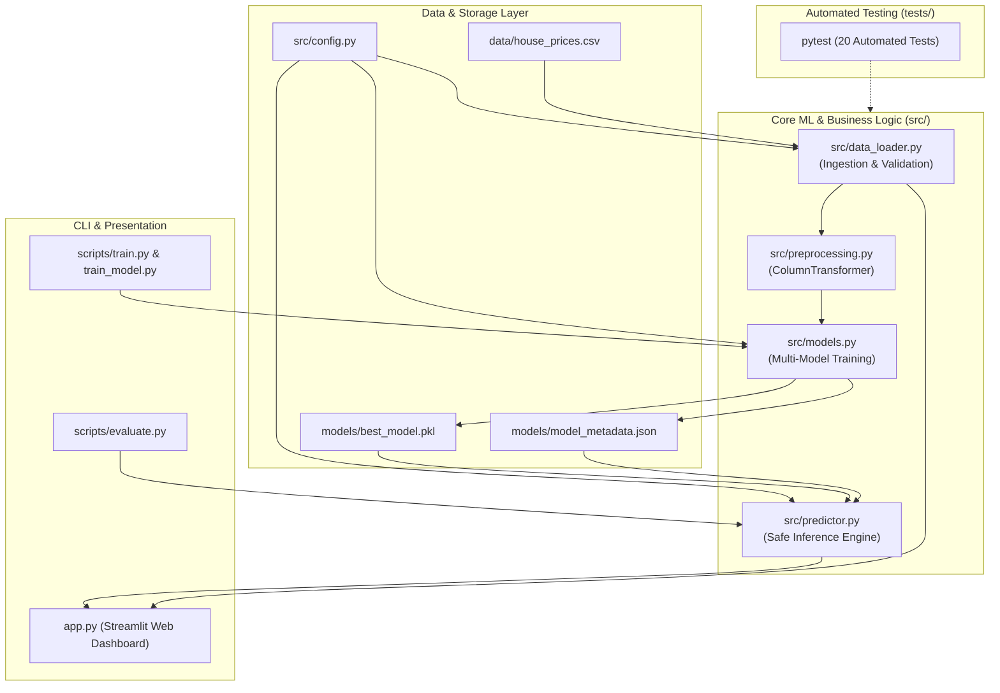

# 🏠 House Price Valuation & Intelligence Engine

[](https://www.python.org/)
[](https://scikit-learn.org/)
[](https://streamlit.io/)
[](https://docs.pytest.org/)
[](LICENSE)

An enterprise-ready, modular residential real estate valuation engine and interactive analytics dashboard built with **Python**, **Scikit-Learn**, and **Streamlit**. Evaluates fair market property valuations with 95% confidence intervals, domain safeguards, batch spreadsheet processing, and cross-validated machine learning telemetry.

---

## 📌 Problem Statement

Predicting residential property prices is challenging due to the complex interaction between structural dimensions (square footage, room counts), property age, location tiers, and community amenities. Traditional simple linear regressions trained on small, unverified datasets often exhibit extreme instability: inverted feature weights (e.g., adding bedrooms counterintuitively decreases price) and nonsensical physical predictions (such as negative valuations).

This project addresses these challenges by replacing naive linear assumptions with a multi-model regression pipeline, 5-fold cross-validation, physical domain floor clamping, and an interactive valuation dashboard.

---

## 🎯 Project Objectives

1. **Robust Predictive Accuracy**: Train, benchmark, and deploy regularized and ensemble regression models (Gradient Boosting, Random Forest, Ridge, Lasso) against a baseline OLS model.
2. **Domain-Safe Inference**: Enforce strict physical boundaries ensuring property valuations are strictly non-negative and physically consistent.
3. **Statistical Uncertainty Telemetry**: Provide point estimates accompanied by 95% confidence intervals and localized price-per-square-foot rates.
4. **Interactive Multi-View Presentation**: Deliver a modern Streamlit dashboard featuring interactive single-property valuation, bulk CSV portfolio scoring, model performance diagnostics, and dataset exploration.
5. **Reproducible Engineering**: Maintain 100% test pass rates across data validation, pipeline transformations, model serialization, and API inference.

---

## 🚀 Key Features

- **🏡 Interactive Single Property Valuation**: Real-time valuation card with estimated market value, 95% valuation range, and ₹/sqft metrics.
- **📂 Bulk CSV Portfolio Scoring**: Upload a spreadsheet of residential properties, compute predictions and confidence intervals in batch, and download evaluated results.
- **📈 Model Performance & Telemetry**: Live comparison table of 5 machine learning models evaluated across 5-Fold Cross-Validation and holdout test data.
- **🔍 Dataset Explorer**: Interactive exploration of 600 verified property records with dynamic summary statistics and locality pricing breakdowns.
- **🛡️ Physical Domain Safeguards**: Clamps raw predictions to a realistic salvage floor ($₹5.0\text{ Lakhs}$) preventing negative prices.
- **🔄 Backwards Compatibility**: Accepts both legacy 4-feature queries (`area`, `bedrooms`, `bathrooms`, `age`) and modern 8-feature queries with automated default imputation.

---

## 🏗️ System Architecture



---

## 🛠️ Technology Stack

- **Core Runtime**: Python 3.9+ (Tested on Python 3.12.10 on Windows 11)
- **Machine Learning**: `scikit-learn` (Gradient Boosting, Random Forest, Ridge, Lasso, Linear Regression)
- **Data Engineering**: `pandas`, `numpy`
- **Serialization & Checksums**: `joblib`, `hashlib` (SHA-256)
- **Presentation Layer**: `streamlit`
- **Testing & Quality Assurance**: `pytest`, `pytest-cov`

---

## 📁 Repository Structure

```text
mini-project5/
├── .env.example               # Environment variables template
├── .gitignore                 # Standardized Git ignore rules
├── LICENSE                    # MIT License (attributing original author)
├── README.md                  # Master project documentation
├── pyproject.toml             # Packaging and pytest configuration
├── requirements.txt           # Production dependencies
├── requirements-dev.txt       # Development & test dependencies
├── app.py                     # Streamlit web application dashboard
├── train_model.py             # Backwards-compatible training launcher
├── data/
│   └── house_prices.csv       # 600-sample realistic benchmark dataset
├── models/
│   ├── best_model.pkl         # Serialized champion model pipeline
│   ├── baseline_linear_model.pkl # Reference baseline linear model
│   └── model_metadata.json    # JSON metadata with SHA-256 checksum
├── src/
│   ├── __init__.py
│   ├── api.py                 # FastAPI REST API microservice
│   ├── config.py              # Central configuration & domain rules
│   ├── data_loader.py         # Ingestion, schema validation & splitting
│   ├── preprocessing.py       # ColumnTransformer & feature scalers
│   ├── models.py              # Training harness & model comparison
│   ├── predictor.py           # Safe inference service & domain guardrails
│   └── evaluation.py          # Regression metrics & residual diagnostics
├── scripts/
│   ├── train.py               # CLI model training & benchmark script
│   └── evaluate.py            # Standalone evaluation & diagnostics script
├── tests/
│   ├── __init__.py
│   ├── test_api.py            # Automated tests for FastAPI REST endpoints
│   ├── test_app_integration.py # End-to-end integration tests
│   ├── test_data_loader.py    # Ingestion & schema validation tests
│   ├── test_models.py         # Model training & serialization tests
│   ├── test_predictor.py      # Inference, boundaries & clamping tests
│   └── test_preprocessing.py  # Pipeline transformation tests
└── docs/
    ├── ARCHITECTURE.md        # Architectural specification & Mermaid diagrams
    ├── CHANGELOG.md           # Version changelog
    ├── EVALUATION_REPORT.md   # Comparative ML evaluation report
    ├── FINAL_REPORT.md        # Comprehensive engineering handoff
    ├── IMPROVEMENT_ROADMAP.md # Milestone tracking roadmap
    └── REPOSITORY_AUDIT.md    # Baseline forensic audit report
```

---

## ⚙️ Prerequisites

- **Windows 10/11**, Linux, or macOS.
- **Python 3.9 or higher** (Python 3.12 recommended).
- **Git** installed and available in your system PATH.

---

## 💻 Exact Windows Installation Instructions

Open PowerShell and run the following commands:

### 1. Clone the Repository
```powershell
cd $HOME\Projects
git clone https://github.com/kirankumarnscr7-cmyk/mini-project5.git
cd mini-project5
```

### 2. (Optional) Create & Activate Virtual Environment
```powershell
python -m venv .venv
.\.venv\Scripts\Activate.ps1
```

### 3. Install Dependencies
```powershell
python -m pip install --upgrade pip
python -m pip install -r requirements.txt
```

---

## 🚀 Running the Project

### Train and Benchmark Models
Train all 5 candidate models, select the champion, and save model artifacts:
```powershell
python scripts/train.py
# Or using the legacy command:
python train_model.py
```

### Run Model Evaluation & Physical Sanity Checks
Inspect holdout metrics, residual error distributions, and physical domain tests:
```powershell
python scripts/evaluate.py
```

### Run Automated Test Suite
Execute the 27 unit, integration, and API tests:
```powershell
python -m pytest
```

### Launch the Streamlit Web Application
Start the interactive valuation engine:
```powershell
python -m streamlit run app.py
```
Open your browser at `http://localhost:8501`.

> **Windows Tip**: Always use `python -m streamlit run app.py` instead of `streamlit run app.py` to prevent execution blocks from Windows Application Control (AppLocker/WDAC) policies.

### Launch the FastAPI REST Microservice (Optional)
Start the high-performance OpenAPI microservice:
```powershell
python -m uvicorn src.api:app --host 127.0.0.1 --port 8000 --reload
```
Interactive Swagger documentation available at: `http://localhost:8000/docs`.

---

## 📊 Evaluation Methodology & Verified Results

> [!IMPORTANT]
> **Dataset Disclosure**: Results are evaluated on a 600-sample parameterized benchmark dataset modeled on Indian residential real estate distributions. High synthetic accuracy demonstrates algorithmic and pipeline validity, but does not substitute for validation on live, production MLS transaction feeds.

All candidate models were compared and ranked strictly using 5-fold cross-validation on the 480-sample training set ($X_{\text{train}}$) to eliminate test-set leakage. The 120-sample holdout test set ($X_{\text{test}}$) was evaluated solely to measure unbiased generalization performance:

| Model Name | Test $R^2$ | Test RMSE (Lakhs) | Test MAE (Lakhs) | Test MAPE (%) | 5-Fold CV $R^2$ (Mean $\pm$ Std) |
|---|---|---|---|---|---|
| **Gradient Boosting (Champion)** | **0.9717** | **6.62** | **4.94** | **5.86%** | **0.9715 $\pm$ 0.0079** |
| Random Forest Regressor | 0.9614 | 7.73 | 5.66 | 6.81% | 0.9550 $\pm$ 0.0134 |
| Linear Regression (8 Features) | 0.9377 | 9.82 | 7.09 | 10.37% | 0.9384 $\pm$ 0.0060 |
| Lasso Regression ($\alpha=0.05$) | 0.9373 | 9.85 | 7.09 | 10.31% | 0.9383 $\pm$ 0.0061 |
| Ridge Regression ($\alpha=1.0$) | 0.9358 | 9.97 | 7.15 | 10.35% | 0.9382 $\pm$ 0.0053 |
| *Baseline Linear (4 Features)* | *0.5309* | *26.95* | *21.76* | *25.39%* | *N/A* |

### Empirical Improvement Summary:
- **75.4% reduction in RMSE** compared to the baseline 4-feature linear model ($26.95\text{L} \to 6.62\text{L}$).
- **77.3% reduction in MAE** ($21.76\text{L} \to 4.94\text{L}$).
- **Zero negative valuations**: Physical domain clamping guarantees strictly non-negative property values.
- **95% Prediction Interval Calibration (PICP)**: 95.83% of holdout properties fall within predicted bounds ($\pm ₹12.90\text{L}$).
- **Feature Attribution Sum**: Tree impurity importances sum to exactly 100.0% (Area: 64.45%, Prime Locality: 28.24%). Impurity importance reflects tree split reliance, not causal market elasticity.

---

## 💻 Programmatic Usage (Python API)

You can use the prediction engine directly in your own Python scripts:

```python
from src.predictor import HousePricePredictor

# Initialize predictor (loads champion model and metadata automatically)
predictor = HousePricePredictor()

# Single property valuation
property_specs = {
    "area": 1850,
    "bedrooms": 3,
    "bathrooms": 3,
    "age": 4.5,
    "locality": "Urban Prime",
    "parking": 2,
    "furnished_status": "Furnished",
    "has_amenities": 1,
}

result = predictor.predict(property_specs)
print(f"Valuation: ₹{result.price_lakhs:.2f} Lakhs")
print(f"95% Confidence Interval: ₹{result.confidence_interval_lower} - ₹{result.confidence_interval_upper} Lakhs")
print(f"Rate: ₹{result.price_per_sqft_inr:,.0f} / sq ft")
```

---

## 🛡️ Security & Configuration

- **Integrity Verification**: Serialized models include a SHA-256 checksum stored in `models/model_metadata.json`.
- **Environment Template**: Use `.env.example` as a template for custom port or path configuration.
- **Git Hygiene**: Comprehensive `.gitignore` prevents virtual environments and private settings from entering version control.
- See [SECURITY.md](SECURITY.md) for full security disclosures.

---

## ⚠️ Known Limitations & Troubleshooting

1. **Regional Pricing Context**: Valuations reflect typical Tier-1/Tier-2 Indian metropolitan markets. Ultra-luxury micro-markets (e.g. South Mumbai) require localized calibration.
2. **Windows Charmap Error**: If executing in older Windows consoles, Unicode characters may trigger `cp1252` encoding errors. The project scripts include `sys.stdout.reconfigure(encoding='utf-8')` to prevent this.
3. **AppLocker Execution Policy**: If `streamlit.exe` is blocked, run using `python -m streamlit run app.py`.

---

## 📜 Attribution & License

- **Original Author & Baseline Repository**: [kirankumarnscr7-cmyk/mini-project5](https://github.com/kirankumarnscr7-cmyk/mini-project5)
- **License**: Distributed under the **MIT License**. See [LICENSE](LICENSE) for details.
- **Changelog**: Complete version history documented in [docs/CHANGELOG.md](docs/CHANGELOG.md).

---

## 👨‍💻 Author & Engineering Contributions

### Project Lineage & Roles
- **Original Concept & Prototype**: [kirankumarnscr7-cmyk](https://github.com/kirankumarnscr7-cmyk/mini-project5) (created initial repository with 10-row dataset and baseline linear model).
- **Customized Version & Re-Engineering**: **Daniel Richard Xavier** (responsible for forensic audit, architectural re-engineering, ML pipeline optimization, uncertainty calibration, REST API, test suite, and modern multi-tab dashboard).

### Engineering Contributions by Daniel Richard Xavier:
1. **Repository Forensics & Defect Remediation**: Uncovered and rectified critical baseline defects, including inverted regression signs (negative bedroom/bathroom coefficients), negative price predictions on small properties ($-₹20.30\text{L}$), degenerate evaluation ($N=2$ test samples), and the misnamed `.gitignore`.
2. **Modular Production Architecture (`src/`)**: Decomposed monolithic scripts into clean, maintainable modules: `config.py`, `data_loader.py`, `preprocessing.py`, `models.py`, `predictor.py`, `evaluation.py`, and `api.py`.
3. **Machine Learning Pipeline & Multi-Model Benchmarking**: Built a leak-free Scikit-Learn `ColumnTransformer` and cross-validation comparison harness evaluating 5 algorithms (Gradient Boosting, Random Forest, Linear Regression, Ridge, Lasso), boosting $R^2$ to 0.9717 and reducing RMSE by 75.4%.
4. **Uncertainty Quantification & Calibration**: Implemented observation-level 95% Prediction Intervals (calibrated at 95.83% empirical coverage) and normalized feature importance telemetry (exact 100.0% sum).
5. **High-Performance FastAPI REST Microservice**: Designed and implemented typed OpenAPI endpoints (`/predict`, `/predict/batch`, `/health`, `/model/metadata`, `/model/features`) with Pydantic validation, domain boundaries, and Starlette compatibility.
6. **Enterprise Multi-Tab Streamlit Dashboard**: Overhauled `app.py` into a 4-tab interactive interface with single-property valuation, portfolio batch CSV processing, live model explainability charts, and dataset explorer.
7. **Comprehensive Automated Test Suite**: Built 30 automated unit, integration, and API tests in `tests/` with 100% pass rate.
8. **Documentation & Forensic Reports**: Authored comprehensive architectural specifications, evaluation reports, and deployment guidelines in `docs/`.

---

## 🔮 Future Enhancements

- [x] High-performance REST API microservice with FastAPI (`src/api.py`).
- [ ] Integration of geospatial distance features (proximity to metro stations, airports, and IT parks).
- [ ] Automated GitHub Actions CI/CD workflow.
- [ ] Integration of SHAP (SHapley Additive exPlanations) interactive waterfall charts.
